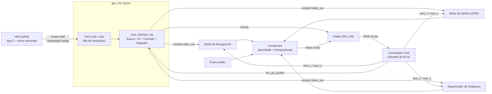

Universidade Estadual de Feira de Santana (UEFS)
Departamento de Tecnologia - Área de Eletrônica
Disciplina: Sistemas Digitais (TEC499) - 2026.2

# Problema #2 — Coprocessador Gráfico Programável

**Autores:** Felipe Gomes e Caio Bruno Oliveira

## Descrição do Projeto

Este projeto transforma o núcleo gráfico desenvolvido no Problema 1 (background, sprites e polígonos) em um coprocessador gráfico programável na FPGA Cyclone V da DE1-SoC. Em vez de controlar cada módulo gráfico individualmente, a aplicação passa a enviar instruções de 32 bits ao coprocessador; o hardware busca, decodifica e executa cada instrução, acionando a unidade funcional correspondente.

O processador ARM (HPS) executa uma aplicação em C que usa um driver em Assembly ARM (`gpu_driver.s`); o driver mapeia o coprocessador via `/dev/mem` e envia as instruções por MMIO (ponte Lightweight HPS-to-FPGA) para uma fila (FIFO) interna. Uma unidade de controle (FSM) retira as instruções da fila, armazena-as no Registrador de Instrução (IR), decodifica os campos e atualiza o datapath que alimenta os motores gráficos. O compositor, a unidade de controle de quadro e o controlador VGA operam continuamente, independentes da execução das instruções.

O ambiente de desenvolvimento utilizado foi o Quartus Prime Lite (25.1std) e a linguagem de descrição de hardware foi Verilog.


*Imagem da placa DE1-SoC retirada do site da Altera*

## Sumário

1. [Resumo de Conformidade](#1-resumo-de-conformidade)
2. [Levantamento de Requisitos](#2-levantamento-de-requisitos)
3. [Requisitos Atendidos e Como Foram Cumpridos](#3-requisitos-atendidos-e-como-foram-cumpridos)
4. [Requisitos Parcialmente Atendidos e Não Atendidos](#4-requisitos-parcialmente-atendidos-e-não-atendidos)
5. [Softwares Utilizados](#5-softwares-utilizados)
6. [Hardware Usado nos Testes](#6-hardware-usado-nos-testes)
7. [Arquitetura do Sistema](#7-arquitetura-do-sistema)
8. [Instalação e Configuração](#8-instalação-e-configuração)
9. [Testes e Funcionamento](#9-testes-e-funcionamento)
10. [Análise dos Resultados](#10-análise-dos-resultados)
11. [Referências](#11-referências)

---

## 1. Resumo de Conformidade

Legenda: ✅ atendido · ⚠️ parcialmente atendido · ❌ não atendido.

| Item | Requisito (Problema #2) | Status |
|---|---|---|
| R01 | ISA de 32 bits | ✅ |
| R02 | Unidade de busca de instruções | ✅ |
| R03 | Registrador de Instrução (IR) | ✅ |
| R04 | Unidade de Controle | ✅ |
| R05 | Datapath | ✅ |
| R06 | Banco de registradores | ⚠️ (distribuído por motor — decisão de projeto) |
| R07 | Unidade Lógica e Aritmética (ULA) | ⚠️ (aritmética distribuída nos motores — decisão de projeto) |
| R08 | Registrador de status / registradores de estado | ⚠️ |
| R09 | Mecanismo de comunicação valid, busy e done | ⚠️ |
| R10 | Motor de Background como unidade funcional | ✅ |
| R11 | Motor de Sprites como unidade funcional | ✅ |
| R12 | Rasterizador de Polígonos como unidade funcional | ✅ |
| R13 | Unidade de Controle de Quadro | ✅ |
| R14 | Compositor | ✅ |
| R15 | Controlador VGA | ✅ |
| R16 | Compositor, controle de quadro e VGA operando continuamente | ✅ |
| R17 | Mecanismo de sincronização com o VGA | ✅ |
| R18 | Toda operação gráfica como consequência de uma instrução da ISA | ✅ |
| R19 | Busca de instruções (passiva, via fila MMIO do ARM) | ✅ |
| R20 | Programa em Assembly do ARM (busca passiva) | ✅ |
| R21 | Programa de demonstração da ISA + sintaxe definida | ⚠️ (aplicação em C — decisão de projeto) |
| R22 | Aplicação em C que usa o coprocessador (preparação para a próxima etapa) | ✅ |
| E01 | Código RTL completo e top-level da DE1-SoC | ✅ |
| E02 | Projeto Quartus completo | ✅ |
| E03 | Relatório de síntese, recursos, Fmax e timing | ✅ |
| E04 | Testbench por módulo principal e de integração | ❌ (preencher) |
| E05 | Demonstração em hardware | [preencher] |

Os detalhes estão na seção 3 (atendidos) e na seção 4 (parciais e não atendidos).

---

## 2. Levantamento de Requisitos

### 2.1 Requisitos Funcionais

- **RF01:** O coprocessador deve possuir uma ISA de 32 bits, definida e documentada pela equipe.
- **RF02:** Deve implementar o ciclo de busca/execução de instruções, com unidade de busca, Registrador de Instrução (IR) e Unidade de Controle.
- **RF03:** Deve possuir datapath, banco de registradores, Unidade Lógica e Aritmética (ULA) e registradores de estado/status.
- **RF04:** Os motores de background, sprites e polígonos devem ser tratados como unidades funcionais acionadas por instruções.
- **RF05:** Deve haver unidade de controle de quadro, compositor e controlador VGA operando continuamente, independentemente da execução das instruções.
- **RF06:** Deve existir mecanismo de sincronização com o VGA.
- **RF07:** Deve existir mecanismo de comunicação do tipo valid, busy e done.
- **RF08:** Toda operação deve ocorrer como consequência da execução de uma instrução da ISA.
- **RF09:** As instruções devem ser obtidas por busca síncrona ou por busca assíncrona*.
- **RF10:** Deve haver pelo menos um programa de demonstração da ISA da equipe, com sintaxe definida. A equipe optou por implementá-lo como aplicação em C que gera as instruções da ISA, sobre um driver em Assembly ARM.

### 2.2 Requisitos Não Funcionais

- **RNF01:** O núcleo deve ser descrito em Verilog e implementado na FPGA da DE1-SoC.
- **RNF02:** A arquitetura deve ser modular, separando busca/controle, datapath, memórias, unidades funcionais e saída de vídeo.
- **RNF03:** O núcleo deve estar preparado para ser controlado por um driver Linux em Assembly ARM e por uma aplicação em C (etapas posteriores).
- **RNF04:** Entregar RTL completo, projeto Quartus compilável, repositório organizado e README com a documentação exigida.
- **RNF05:** Validar com testbench por módulo principal e testbench de integração.
- **RNF06:** Apresentar relatório de síntese, utilização de recursos, frequência máxima e análise de timing.
- **RNF07:** A demonstração deve ser feita na placa; vídeo ou simulação não a substituem.

---

## 3. Requisitos Atendidos e Como Foram Cumpridos

Para cada requisito atendido são indicados o(s) módulo(s), como foi cumprido e um espaço para registrar como foi demonstrado na placa.

### R01 / R18 — ISA de 32 bits; toda operação é consequência de uma instrução ✅

**Módulo:** `mvp_interface_bg.v`.

**Como foi cumprido:** Foi definida uma ISA de 32 bits, em que cada instrução endereça uma unidade funcional (*engine*) e uma operação (*reg*) dentro dela. Todas as ações gráficas dinâmicas (scroll, cor de fundo, posição/padrão/flags de sprite, retângulo, triângulo e escrita na paleta) só acontecem como resultado da execução de uma instrução. A especificação completa está na seção 7.3.

📷 **Demonstração:** [PREENCHER: instruções executadas na apresentação e o efeito observado na tela.]

### R02 / R03 / R04 / R19 — Unidade de busca, IR e Unidade de Controle (busca passiva) ✅

**Módulos:** `gpu_top.v` (interface Avalon-MM e FIFO), `fifo_32bcomand` (IP `scfifo`, 256 × 32 bits), `mvp_interface_bg.v` (FSM).

**Como foi cumprido:** A busca é assíncrona: o ARM escreve instruções no offset `0x00` do `gpu_top`, que as enfileira na FIFO. A unidade de busca é a lógica que retira palavras da FIFO (`fifo_rdreq`), e a palavra lida é armazenada no IR (`command_reg`). A Unidade de Controle é uma FSM de 5 estados:

| Estado | Ação |
|---|---|
| `IDLE` | Se a FIFO não está vazia, solicita a leitura (`fifo_rdreq`) |
| `WAIT_FIFO` | Espera a latência de leitura da FIFO |
| `READ_FIFO` | Captura a palavra no IR (`command_reg`) |
| `EXECUTE` | Decodifica engine / reg / valor e atualiza o datapath |
| `HOLD` | Estado de acomodação antes de retornar a `IDLE` |

📷 **Demonstração:** [PREENCHER: fluxo ARM → FIFO → decodificador → motor gráfico mostrado na apresentação.]

### R05 — Datapath ✅

**Módulos:** `mvp_interface_bg.v`, `gpu_top.v`, `ghrd_top.v`.

**Como foi cumprido:** O datapath é formado pelos campos decodificados do IR (`cmd_engine`, `cmd_reg`, `cmd_value`), por registradores de rascunho (*staging*) de retângulo, triângulo e paleta, pelo bloco de normalização do scroll (comparação e subtração) e pelos registradores de saída que alimentam os motores gráficos. Esses sinais saem do `gpu_top` por um conduit (`video_out`) exportado do Qsys para o `ghrd_top`. Retângulos e triângulos são atualizados em duas etapas (rascunho/commit): as instruções de vértices gravam em registradores internos e a instrução `*_STYLE` aplica todos os valores de uma vez, evitando que a primitiva pisque ou "teleporte".

### R10 — Motor de Background como unidade funcional ✅

**Módulos:** `background_renderer.v`, `ram_tilemap_2port` (`tilemap_back.mif`), `ram_tile` (`tile_back.mif`).

**Como foi cumprido:** O motor renderiza um tilemap de 40×30 posições com tiles 8×8 (256 padrões) e é acionado pelas instruções `BG_SCROLL` (deslocamento horizontal/vertical com repetição *wrap-around*) e `BG_COLOR` (cor sólida de fundo). O endereço do tilemap é `tile_y × 40 + tile_x`, calculado sem multiplicador.

📷 **Demonstração:** [PREENCHER: BG_SCROLL em ação na placa.]

### R11 — Motor de Sprites como unidade funcional ✅

**Módulos:** `motor_sprite.v`, `rom_memoria2` (`espace_invasor.mif`).

**Como foi cumprido:** O motor mantém uma OAM com atributos de 32 sprites 16×16 (X, Y, padrão, habilitação, espelhamento H e V), editada por instrução: `SPR_ID` seleciona o sprite e `SPR_POS`, `SPR_TILE` e `SPR_FLAGS` gravam seus atributos por pulsos de escrita seletivos. Cada sprite usa 4 subtiles 8×8, o espelhamento inverte as coordenadas dentro do sprite, e a detecção de hit é feita por varredura paralela dos 32 slots. Em sobreposição, vence o sprite de menor ID.

📷 **Demonstração:** [PREENCHER: sprites movidos pelo ID e espelhados na placa.]

### R12 — Rasterizador de Polígonos como unidade funcional ✅

**Módulo:** `rasterizador_poligonos.v`.

**Como foi cumprido:** Retângulos (comparação de limites) e triângulos (funções de aresta com aritmética inteira, independente da ordem dos vértices, usando 6 blocos DSP) são configurados pelas instruções `RECT_*` e `TRI_*`.

📷 **Demonstração:** [PREENCHER: retângulo e triângulo na tela, cores e posições alteradas por instrução.]

### R13 / R16 / R17 — Unidade de Controle de Quadro, operação contínua e sincronização com o VGA ✅

**Módulos:** `ghrd_top.v`, `vga_driver.v`.

**Como foi cumprido:** O `vga_driver` (máquinas de estados horizontal e vertical, 640×480 @ 60 Hz com pixel clock de 25 MHz) gera continuamente as coordenadas `next_x` / `next_y`, que são convertidas em coordenadas lógicas 320×240 (deslocamento de 1 bit, ampliação 2×2) e distribuídas aos motores gráficos. A lógica de controle de quadro, em `ghrd_top`, gera o pulso `fim_de_quadro` quando o último pixel visível (639, 479) é varrido e o exporta ao Qsys (conduit `vblank`) e ao `gpu_top`, servindo de referência de sincronização com o vídeo. VGA, controle de quadro e compositor não dependem da execução de instruções: continuam operando mesmo com a FIFO vazia.

Um contador de power-on reset (255 ciclos) mantém o sistema em reset após a energização, garantindo saída estável na inicialização.

📷 **Demonstração:** [PREENCHER: imagem estável no monitor, mesmo sem instruções em execução.]

### R14 — Compositor (com paleta programável) ✅

**Módulos:** `ghrd_top.v` (compositor), `paleta_ram` (`paleta.mif`).

**Como foi cumprido:** O compositor combina, a cada pixel, as camadas com prioridade fixa, aplicando a transparência (índice 0) antes da seleção do pixel final:

| Prioridade | Camada | Origem |
|---|---|---|
| 1 (maior) | Sprites | `motor_sprite` |
| 2 | Polígonos (triângulo sobre retângulo) | `rasterizador_poligonos` |
| 3 | Background (tilemap) | `background_renderer` |
| 4 | Frame buffer (VRAM) | `ram_framebuffer` |
| 5 (menor) | Cor sólida de fundo | instrução `BG_COLOR` |

```verilog
wire [7:0] final_pixel_index =
    (spr_active && spr_color != 8'd0) ? spr_color :
    poligonos_visiveis                ? poly_color :
    (bkg_color != 8'd0)               ? bkg_color  :
    (vram_color != 8'd0)              ? vram_color :
                                        bg_color_solid;
```

O índice final de 8 bits é convertido em RGB 24 bits pela `paleta_ram` (256 entradas), reprogramável por instrução (`PAL_RED_ADDR` + `PAL_GB_WRITE`).

📷 **Demonstração:** [PREENCHER: sobreposição de camadas e alteração de paleta por instrução.]

### R15 — Controlador VGA ✅

Ver R13 / R16 / R17. Saída em 640×480 @ ~60 Hz pela interface VGA da DE1-SoC, com sinais RGB zerados fora da região ativa.

### R20 / R22 — Programa em Assembly ARM e aplicação em C ✅

**Arquivos:** `gpu_driver.s` (Assembly ARM), `gpu.c` / `gpu.h`, `main.c`, `background.c`, `sprites.c`, `poligonos.c`, `entrada.c`, `Makefile`.

**Como foi cumprido:** Como a busca é passiva, o ARM precisa produzir as instruções. A solução é dividida em duas camadas:

**Driver em Assembly ARM (`gpu_driver.s`)** — único código que toca o hardware. Compilado para ARMv7 (Cortex-A9), Linux EABI, sintaxe GNU `as`, e usa chamadas de sistema diretamente (`open`, `mmap2`, `munmap`, `close`). Exporta quatro funções:

| Função | Descrição |
|---|---|
| `gpu_init()` | Abre `/dev/mem` (`O_RDWR \| O_SYNC`) e mapeia a página do coprocessador (base `0xFF200000`, ponte Lightweight HPS-to-FPGA, offset 0 do `gpu_top_0` no Qsys). Retorna 0 ou -1 |
| `gpu_close()` | Desfaz o mapeamento (`munmap` + `close`) |
| `gpu_write_cmd(cmd)` | Consulta o bit 0 do status (FIFO cheia) por polling com timeout; quando há espaço, escreve o comando de 32 bits em `REG_CMD` (offset `0x00`) e executa `dmb`. Retorna 0 ou -1 |
| `gpu_read_status()` | Lê o registrador de status (offset `0x04`) |

**Aplicação em C.** `gpu.c` monta a instrução com a macro `GPU_CMD(eng, reg, val)` (`[30:27]` engine, `[26:23]` reg, `[22:0]` valor) e a entrega ao driver, sem acessar o hardware diretamente. Os módulos `background.c`, `sprites.c` e `poligonos.c` expõem funções de alto nível (`bg_scroll`, `spr_mover`, `spr_espelhar`, `ret_mover`, `tri_mover` etc.) e mantêm o estado em software; o hardware recebe sempre a forma completa. A aplicação (`main.c`) é um menu interativo (polígonos, sprites, background, demonstração "tudo" e reset), com uma demo que anima 32 sprites, um retângulo, um triângulo e o scroll do fundo a ~60 quadros/s (≈ 72 instruções por quadro).

O software respeita o handshake *busy*: antes de cada escrita, o driver verifica a flag "FIFO cheia" e só envia quando há espaço.

📷 **Demonstração:** [PREENCHER: execução do `gpu_cli` na placa (menu, demo "tudo") e a imagem resultante.]

### E01 / E02 / E03 — Entregas de RTL, projeto Quartus e relatório de síntese ✅

O RTL completo, o top-level (`ghrd_top.v`), o projeto Quartus (`soc_system.qpf`) e os relatórios de compilação (`output_files/`) estão no repositório. Os números de recursos e timing estão na seção 10.

---

## 4. Requisitos Parcialmente Atendidos e Não Atendidos

| Item | Situação | Detalhe |
|---|---|---|
| R06 — Banco de registradores | Parcialmente | Não existe um banco de registradores central. **Decisão de projeto:** cada motor possui seu próprio conjunto de registradores — a OAM (64 entradas de atributos, selecionada por `SPR_ID`), os registradores de rascunho e de saída do retângulo e do triângulo, os de scroll e cor de fundo, e a paleta (RAM 256 × 24 bits). O campo `REG` da instrução endereça diretamente o registrador dentro de cada engine. |
| R07 — ULA | Parcialmente | Não há módulo ULA dedicado. **Decisão de projeto:** as operações aritméticas são realizadas dentro dos módulos que precisam delas — adições/subtrações (soma de scroll e wrap, endereço do tilemap, deslocamentos e detecção de hit dos sprites, vetores de aresta) e multiplicações (funções de aresta do triângulo, mapeadas em 6 blocos DSP). A ISA não possui instruções aritméticas (apenas configuram as unidades), e a aritmética dos motores precisa ser avaliada a cada pixel; por isso uma ULA central compartilhada não foi adotada. Esta abordagem difere da arquitetura sugerida no enunciado. |
| R08 — Registrador de status | ⚠️ | O status (offset `0x04`) é formado diretamente pelas flags da FIFO: bit 0 = cheia, bit 1 = vazia. Não há registrador de status independente (por exemplo, instrução em execução ou erro de decodificação). |
| R09 — valid / busy / done | ⚠️ | `valid` corresponde à escrita na FIFO (`wrreq`); `busy` ao bit "FIFO cheia"; `done` ao bit "FIFO vazia". O driver ARM faz o handshake por polling de `busy` com timeout antes de cada escrita; em hardware a escrita não é bloqueada com a FIFO cheia. Não há sinal de `done` por instrução. |
| R21 — Programa em Assembly da ISA e sintaxe | Parcialmente | **Decisão de projeto:** em vez de um programa em um assembler próprio, a ISA é programada por uma aplicação em C, que gera as palavras de 32 bits por meio da macro `GPU_CMD(eng, reg, val)` e as envia pelo driver Assembly ARM. A "sintaxe" da ISA é a tabela de instruções da seção 7.3 (campos `ENGINE` / `REG` / `VALOR`) e as funções C correspondentes. Não existe montador textual dedicado. |
| E04 — Testbenches | ❌ | [PREENCHER: o pacote analisado não contém testbenches. Se existirem, listar por módulo, o de integração e os scripts de automação.] |

### Observações sobre o software

- `gpu_wait_vblank()` (em `gpu.c`) lê o bit 2 do status como V-Blank, mas o hardware só implementa os bits 0 (cheia) e 1 (vazia). A função não é chamada pela aplicação (a animação usa `usleep(16667)`), mas, se fosse usada, ficaria presa. É necessário remover a função ou implementar o bit de V-Blank no status.
- A aplicação em C usa as engines `0x1` (apenas `BG_SCROLL`), `0x2`, `0x3` e `0x4`; as instruções de paleta (`0x5`) e `BG_COLOR` existem no hardware, mas não são utilizadas pelo software atual.
- O comentário `TODO` em `gpu_driver.s` sobre `GPU_OFFSET` pode ser removido: o valor `0x0` coincide com o endereço-base do `gpu_top_0` no Qsys.

### Observações sobre a unidade de controle de quadro

- O hardware de troca de bancos (*double buffering*) foi preparado (OAM com 64 posições, tilemap com 4096 posições, bit `bank_read`), mas no `ghrd_top` o `bank_read` está fixo em `1'b0`; a troca de bancos por `fim_de_quadro` não está ativa.
- Instruções com `ENGINE` / `REG` não definidos são ignoradas, sem sinalização de erro ao software.
- O arquivo `unidade_de_controle.v` (FSM por botões/chaves, herdada do Problema 1) consta no projeto, mas não é instanciado; a cena é controlada apenas por instruções.

---

## 5. Softwares Utilizados

- **IDE de Desenvolvimento:** Intel Quartus Prime Lite Edition (25.1std, build 1129)
- **Integração de sistema:** Platform Designer (Qsys) — HPS + `gpu_top` + PIO + JTAG UART
- **Simulador:** [PREENCHER: ModelSim/Questa, se utilizado]
- **Linguagem HDL:** Verilog-2001
- **Software no HPS:** GCC (nativo na placa ou `arm-linux-gnueabihf-gcc` para cross-compilação), GNU `as` para o driver em Assembly ARMv7, `make`; Linux no HPS
- **VSCode:** Para a programação dos modulos em C

---

## 6. Hardware Usado nos Testes

- Kit de Desenvolvimento Terasic DE1-SoC [PREENCHER: revisão da placa]
- FPGA Intel Cyclone V 5CSEMA5F31C6
- Processador HPS ARM Cortex-A9 Dual-Core
- Monitor VGA [PREENCHER: modelo] — 640×480 @ ~60 Hz

---

## 7. Arquitetura do Sistema

### 7.1 Visão Geral



O decodificador opera no clock de 50 MHz (o mesmo do Qsys); os motores gráficos, o compositor, a paleta e o VGA operam em `clk_25m`.

Mapeamento para os blocos exigidos no Problema #2:

| Bloco exigido | Implementação |
|---|---|
| Unidade de busca | Leitura da FIFO (`fifo_32bcomand` + estados `IDLE` / `WAIT_FIFO` do `mvp_interface_bg`) |
| IR | `command_reg` (`mvp_interface_bg`) |
| Unidade de Controle | FSM do `mvp_interface_bg` |
| Datapath | Campos do IR, registradores de rascunho, normalização de scroll e registradores de saída |
| Banco de registradores / ULA / status | Parcial / ausente / flags da FIFO (seção 4) |
| Unidades funcionais gráficas | `background_renderer`, `motor_sprite`, `rasterizador_poligonos` |
| Unidade de Controle de Quadro | Geração de `fim_de_quadro` no `ghrd_top` |
| Compositor | Bloco `final_pixel_index` + `paleta_ram` no `ghrd_top` |
| Controlador VGA | `vga_driver` |

### 7.2 Descrição dos Módulos

**`ghrd_top.v`** — Top-level da DE1-SoC: instancia o `soc_system` (HPS + `gpu_top`), os motores gráficos, as memórias, a paleta e o `vga_driver`; divide o clock para 25 MHz, gera o power-on reset, converte coordenadas físicas em lógicas (ampliação 2×2), gera `fim_de_quadro` e implementa o compositor.

**`gpu_top.v`** — Interface do coprocessador (Avalon-MM Slave): recebe as escritas do ARM, enfileira-as na FIFO (offset `0x00`), expõe o status (offset `0x04`) e instancia o decodificador.

**`mvp_interface_bg.v`** — Busca/Decodificação/Controle: FSM descrita na seção 3, IR, registradores de rascunho e execução atômica (*commit*) de primitivas.

**`vga_driver.v`** — Controlador VGA: máquinas de estados horizontal e vertical; emite `next_x` / `next_y` antecipadamente para compensar a latência de pipeline dos motores.

| Parâmetro | Horizontal | Vertical |
|---|---|---|
| Pixels ativos | 640 | 480 |
| Front porch | 16 | 10 |
| Sync pulse | 96 | 2 |
| Back porch | 48 | 33 |

**`background_renderer.v`**, **`motor_sprite.v`**, **`rasterizador_poligonos.v`** — unidades funcionais gráficas (seção 3).

**IPs gerados no Quartus:** `fifo_32bcomand`, `ram_tile`, `ram_tilemap_2port`, `rom_memoria2`, `paleta_ram`, `ram_framebuffer`.

### 7.3 ISA do Coprocessador

**Formato da instrução (32 bits):**

```text
 31 | 30        27 | 26        23 | 22                          0
----+--------------+--------------+------------------------------
  0 |    ENGINE    |     REG      |            VALOR
```

| Campo | Bits | Descrição |
|---|---|---|
| Reservado | 31 | Ignorado |
| ENGINE | 30:27 | Unidade funcional destino |
| REG | 26:23 | Operação/registrador dentro da engine |
| VALOR | 22:0 | Operando(s), conforme a instrução |

| ENGINE | REG | Mnemônico | Campos de VALOR | Efeito |
|---|---|---|---|---|
| `0x1` BG | `0x0` | `BG_SCROLL` | `[8:0]` X, `[16:9]` Y | Define o scroll (normalizado módulo 320×240) |
| `0x1` BG | `0x1` | `BG_COLOR` | `[7:0]` cor | Cor sólida de fundo (menor prioridade) |
| `0x2` SPR | `0x0` | `SPR_ID` | `[4:0]` id | Seleciona o sprite (0–31) a ser editado |
| `0x2` SPR | `0x1` | `SPR_POS` | `[8:0]` X, `[16:9]` Y | Posição do sprite selecionado |
| `0x2` SPR | `0x2` | `SPR_TILE` | `[7:0]` índice | Padrão gráfico (tile base) |
| `0x2` SPR | `0x3` | `SPR_FLAGS` | `[0]` enable, `[1]` hflip, `[2]` vflip | Habilitação e espelhamentos |
| `0x3` RECT | `0x0` | `RECT_P0` | `[8:0]` x0, `[16:9]` y0 | Rascunho: canto superior esquerdo |
| `0x3` RECT | `0x1` | `RECT_P1` | `[8:0]` x1, `[16:9]` y1 | Rascunho: canto inferior direito |
| `0x3` RECT | `0x2` | `RECT_STYLE` | `[7:0]` cor, `[8]` enable | Commit: aplica coordenadas, cor e habilitação |
| `0x4` TRI | `0x0` | `TRI_V0` | `[9:0]` x0, `[18:10]` y0 (com sinal) | Rascunho: vértice 0 |
| `0x4` TRI | `0x1` | `TRI_V1` | `[9:0]` x1, `[18:10]` y1 (com sinal) | Rascunho: vértice 1 |
| `0x4` TRI | `0x2` | `TRI_V2` | `[9:0]` x2, `[18:10]` y2 (com sinal) | Rascunho: vértice 2 |
| `0x4` TRI | `0x3` | `TRI_STYLE` | `[7:0]` cor, `[8]` enable | Commit: aplica vértices, cor e habilitação |
| `0x5` PAL | `0x0` | `PAL_RED_ADDR` | `[15:8]` índice, `[7:0]` R | Rascunho: endereço e vermelho |
| `0x5` PAL | `0x1` | `PAL_GB_WRITE` | `[15:8]` G, `[7:0]` B | Grava {R,G,B} na entrada selecionada |

Combinações de `ENGINE` / `REG` não listadas são ignoradas.

**Mapa MMIO** (escravo `gpu_top_0` na ponte Lightweight HPS-to-FPGA, endereçamento por palavra):

| Offset | Acesso | Descrição |
|---|---|---|
| `0x00` | Escrita | Empilha uma instrução de 32 bits na FIFO (*valid*) |
| `0x04` | Leitura | Status: bit 0 = FIFO cheia (*busy*), bit 1 = FIFO vazia (*done*) |

**Sintaxe Assembly da ISA:** [PREENCHER: sintaxe definida pela equipe, ex.: `SPR_POS id, x, y`, e como é montada em palavras de 32 bits.]

### 7.4 Memórias Utilizadas

| Módulo | Arquivo MIF | Tamanho | Conteúdo |
|---|---|---|---|
| `fifo_32bcomand` | — | 256 × 32 bits | Fila de instruções vindas do ARM |
| `ram_tile` | `tile_back.mif` | 16.384 × 8 bits | Tileset de background (256 tiles × 64 px) |
| `ram_tilemap_2port` | `tilemap_back.mif` | 4.096 × 8 bits (1.200 usadas) | Mapa de tiles 40×30 |
| `rom_memoria2` | `espace_invasor.mif` | 16.384 × 8 bits | Tileset de sprites |
| `paleta_ram` | `paleta.mif` | 256 × 24 bits | Paleta RGB (programável por instrução) |
| `ram_framebuffer` | — | 76.800 × 8 bits | VRAM 320×240 (leitura habilitada; escrita reservada à etapa seguinte) |
| OAM (`motor_sprite`) | — | 64 × (9+8+8+1+1+1 bits) | Atributos dos sprites (registradores) |

### 7.5 Software (Aplicação em C e Driver Assembly ARM)

```text
main.c / menus (background.c, sprites.c, poligonos.c, entrada.c)   <- aplicação em C
        │  gpu_send(engine, reg, valor)
        ▼
gpu.c — GPU_CMD(eng, reg, val) monta a palavra de 32 bits
        │  gpu_write_cmd(cmd)
        ▼
gpu_driver.s — Assembly ARM: open/mmap2 de /dev/mem, polling de BUSY, str na FIFO
        │  MMIO (0xFF200000, ponte Lightweight HPS-to-FPGA)
        ▼
gpu_top (FIFO → decodificador → motores gráficos)
```

Correspondência entre as instruções da ISA e o software (os mnemônicos são nomes de documentação; no código as instruções são geradas por `GPU_CMD`):

| Instrução | Função C | Instruções enviadas |
|---|---|---|
| `BG_SCROLL` | `bg_scroll(x, y)` | `ENG_BG`, 0 |
| `SPR_ID`, `SPR_POS`, `SPR_TILE`, `SPR_FLAGS` | `spr_mover`, `spr_mudar_tile`, `spr_espelhar`, `spr_girar`, `spr_reset` | `ENG_SPR`, 0..3 |
| `RECT_P0`, `RECT_P1`, `RECT_STYLE` | `ret_mover`, `ret_cor`, `poligonos_reset` | `ENG_RECT`, 0..2 |
| `TRI_V0..V2`, `TRI_STYLE` | `tri_mover`, `tri_cor`, `poligonos_reset` | `ENG_TRI`, 0..3 |
| `BG_COLOR`, `PAL_RED_ADDR`, `PAL_GB_WRITE` | — (não usadas pela aplicação atual) | — |

---

## 8. Instalação e Configuração

1. Clone este repositório para a sua máquina local.
2. Abra o Intel Quartus Prime Lite Edition.
3. Vá em **File > Open Project** e selecione `soc_system.qpf` (entidade de topo: `ghrd_top`).
4. Se necessário, regenere o sistema no Platform Designer (`soc_system.qsys`) via **Generate HDL**.
5. Clique em **Start Compilation** e aguarde a finalização ("Successful").
6. Conecte a DE1-SoC via USB-Blaster, ligue a placa, abra o **Programmer** e grave `output_files/soc_system.sof`.

> **Nota:** os arquivos `.mif` e a atribuição de pinos já estão incluídos no projeto.

**Compilação e execução do software (no HPS):**

1. Copie os arquivos de software (`Makefile`, `*.c`, `*.h`, `gpu_driver.s`) para a placa, ou cross-compile no computador com `make CC=arm-linux-gnueabihf-gcc`.
2. Na placa (já com o `.sof` gravado e o Linux em execução), compile com `make` (o Makefile usa `-no-pie`, pois o driver em Assembly usa endereços absolutos).
3. Execute com privilégios de superusuário, pois o driver acessa `/dev/mem`: `sudo ./gpu_cli`.
4. Use o menu: **[1]** Polígonos, **[2]** Sprites, **[3]** Background, **[4]** Demonstração "tudo" (Enter para parar), **[5]** Reset da tela, **[0]** Sair.

O endereço físico utilizado é `0xFF200000` (ponte Lightweight HPS-to-FPGA) + offset `0x0` do `gpu_top_0`, configurado no início de `gpu_driver.s`.

<!-- Imagens do processo de compilação/gravação: inserir aqui -->

---

## 9. Testes e Funcionamento

### 9.1 Simulação

[PREENCHER: testbenches por módulo principal (decodificador/FSM, FIFO/interface, background, sprites, rasterizador, compositor, VGA) e testbench de integração; comandos de execução, scripts de automação e resultados (formas de onda).]

| Módulo | Testbench | O que valida | Resultado |
|---|---|---|---|
| `mvp_interface_bg` | [PREENCHER] | Decodificação de cada instrução da ISA | [PREENCHER] |
| `gpu_top` | [PREENCHER] | Escrita na FIFO e leitura de status | [PREENCHER] |
| `motor_sprite` | [PREENCHER] | Hit, prioridade e espelhamento | [PREENCHER] |
| `rasterizador_poligonos` | [PREENCHER] | Retângulo e triângulo | [PREENCHER] |
| `background_renderer` | [PREENCHER] | Scroll e wrap-around | [PREENCHER] |
| `vga_driver` | [PREENCHER] | Temporização 640×480 @ 60 Hz | [PREENCHER] |
| Integração | [PREENCHER] | Programa completo ARM → imagem | [PREENCHER] |

### 9.2 Demonstração em Hardware

| Teste | Instruções utilizadas | Resultado esperado | Evidência |
|---|---|---|---|
| Vídeo estável sem instruções | — | Imagem estável com FIFO vazia | [foto] |
| Scroll | `BG_SCROLL` | Fundo desloca com wrap-around | [foto] |
| Mover sprite pelo ID (menu Sprites) | `SPR_ID`, `SPR_POS` | Apenas o sprite selecionado se move | [foto] |
| Espelhamento | `SPR_FLAGS` | Sprite espelhado em H e/ou V | [foto] |
| Retângulo / triângulo | `RECT_*`, `TRI_*` | Primitivas preenchidas | [foto] |
| Prioridade entre camadas | combinação | Sprite sobre polígono sobre fundo | [foto] |
| Alteração de paleta | `PAL_RED_ADDR`, `PAL_GB_WRITE` | Cor muda imediatamente | [foto] |
| Demonstração "tudo" (`gpu_cli`, opção 4) | Todas as engines em uso | 32 sprites, retângulo e triângulo rebatendo com o fundo em scroll | [foto] |
| Reset da tela (`gpu_cli`, opção 5) | `BG_SCROLL`, `*_STYLE`, `SPR_FLAGS` | Retorna ao estado inicial | [foto] |

---

## 10. Análise dos Resultados

### 10.1 Resultados Alcançados

- **Coprocessador programável:** os motores do Problema 1 passaram a ser unidades funcionais acionadas por uma ISA de 32 bits, recebida do ARM por FIFO.
- **Ciclo de busca/execução:** FSM com IR e datapath, consumindo instruções continuamente da fila.
- **Pilha completa ARM → FPGA:** aplicação em C, driver em Assembly ARM com `mmap` de `/dev/mem` e handshake por *busy*, FIFO e decodificador em hardware.
- **Operação contínua de vídeo:** VGA, controle de quadro e compositor independem da execução de instruções.
- **Composição e paleta:** 5 níveis de prioridade com transparência pelo índice 0 e paleta de 256 cores programável por instrução.

### 10.2 Utilização de Recursos (Cyclone V 5CSEMA5F31C6)

Fonte: `output_files/soc_system.fit.rpt` (Quartus 25.1std). Inclui o sistema completo (HPS, interconexão, FIFO, memórias gráficas e núcleo).

| Recurso | Utilizado | Disponível | Percentual |
|---|---|---|---|
| ALMs (Lógica) | 3.755 | 32.070 | 12% |
| Registradores | 5.002 | — | — |
| Blocos de RAM (M10K) | 180 | 397 | 45% |
| Bits de memória | 1.432.320 | 4.065.280 | 35% |
| Blocos DSP | 6 | 87 | 7% |
| Pinos | 382 | 457 | 84% |
| PLLs / DLLs | 0 / 1 | 6 / 4 | 0% / 25% |

### 10.3 Timing

Fonte: `output_files/soc_system.sta.rpt` / `.sta.summary` (modelo Slow 1100mV 85C).

| Clock | Fmax | Slack de setup | Slack de hold |
|---|---|---|---|
| `clock_50_1` (CLOCK_50) | 91,67 MHz | +9,091 ns | +0,256 ns |
| `altera_reserved_tck` (JTAG) | 76,38 MHz | +10,120 ns | +0,416 ns |
| `afi_clk_write_clk` (SDRAM do HPS) | — | +1,730 ns | +0,143 ns |

Todos os caminhos analisados fecham timing (TNS = 0) nos modelos reportados.

### 10.4 Desempenho e Gargalos

- **Vazão de instruções:** o decodificador consome uma instrução a cada 5 ciclos de 50 MHz (`IDLE` → `WAIT_FIFO` → `READ_FIFO` → `EXECUTE` → `HOLD`), ≈ 10 milhões de instruções/s, ou ≈ 166 mil por quadro a 60 Hz. A demonstração "tudo" envia ≈ 72 instruções por quadro (≈ 4,3 mil/s), muito abaixo da capacidade; o gargalo real é o acesso do ARM via `/dev/mem` e o `usleep` da aplicação.
- **Varredura de sprites:** 32 slots comparados em paralelo por pixel — simples e sem limite de sprites por linha, mas com custo de lógica combinacional proporcional ao número de sprites.
- **Triângulos:** 6 multiplicadores (DSP) avaliam as funções de aresta em paralelo.
- **Pinos (84%):** consumo elevado pela interface HPS/DDR3 e periféricos da placa.

### 10.5 Limitações e Melhorias Possíveis

- Banco de registradores central, ULA e registrador de status completos.
- Software: remover/corrigir `gpu_wait_vblank()` (bit 2 de status inexistente) e usar `BG_COLOR` e as instruções de paleta na aplicação, para demonstrar a paleta programável.
- Sinais valid/busy/done por instrução, com bloqueio de escrita quando a FIFO está cheia.
- Controle de quadro com troca de bancos ativa (`bank_read` sincronizado com `fim_de_quadro`) para evitar artefatos (*tearing*), já que hoje as instruções são aplicadas assim que decodificadas.
- Sinalização de erro para instruções com `ENGINE` / `REG` inválidos.
- Reset completo dos registradores de saída do decodificador (vários dependem do valor inicial padrão da FPGA).
- Travessia de domínios de clock: decodificador em 50 MHz e motores em `clk_25m` (divisor por registrador), sem sincronizadores nas fronteiras; como o clock de 25 MHz não é declarado no SDC (sem PLL), o Timing Analyzer não o reporta como domínio separado. Recomenda-se usar PLL (ou `create_generated_clock`) e sincronizadores.
- Alinhamento de pipeline entre camadas: as camadas chegam ao compositor com latências distintas; o desvio de 1–2 ciclos é pouco perceptível por causa da duplicação 2×2, mas convém equalizar com registradores de atraso.

### 10.6 Funcionalidades Não Atendidas

Ver a tabela da seção 4.

---

## 11. Referências

ADAMS, V. Hunter. **VGA Driver in Verilog.** [S. l.], [s. d.]. Disponível em: <https://vanhunteradams.com/DE1/VGA_Driver/Driver.html>. Acesso em: 24 ago. 2026.

PATTERSON, David A.; HENNESSY, John L. **Computer Organization and Design: The Hardware/Software Interface, ARM Edition.** [S. l.]: Morgan Kaufmann, 2016. (The Morgan Kaufmann Series in Computer Architecture and Design).
